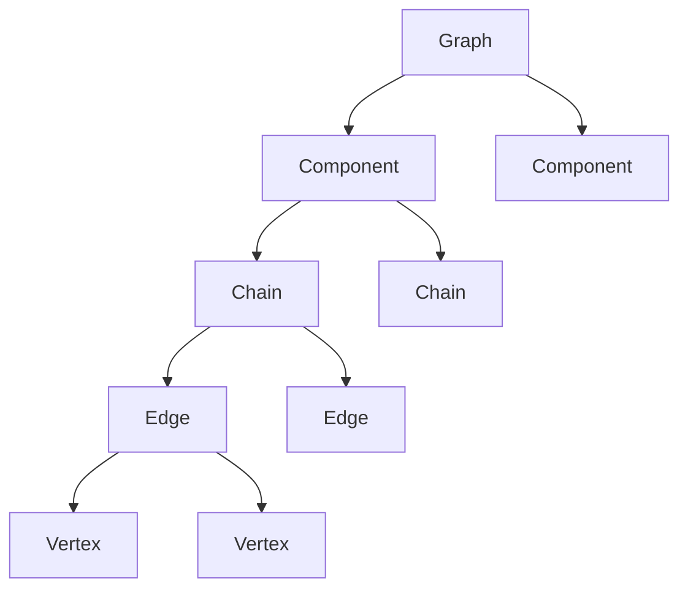

# Concepts

graffine stores a graph in **layers of increasing complexity**. Two major
parts of the library act on them: the **structure**, which defines and holds
the graph elements, and the **transforms**, which modify that structure.



## Edges and vertices

The most elementary layer is a set of **edges** and **vertices**. An edge
spans between a pair of vertices at its ends; the order of the vertices
within the pair defines the edge **direction**.

A vertex's **degree** is the number of edge ends meeting at it. graffine
supports degrees 1 to 4, named `Deg1` ... `Deg4`:

| Degree | Role |
| --- | --- |
| 1 | **Leaf**: a free end of the graph |
| 2 | **Bulk**: a vertex inside a chain |
| 3, 4 | **Junction**: a branching point joining chain ends |

## Chains

A **chain** is a linear run of edges with no branches. Its internal vertices
all have degree 2; its two ends, called **A** (tail) and **B** (head), are
leaves, junctions, or, for a cycle, joined to each other.

Chains are what make graffine efficient for graphs dominated by long
unbranched runs: positions along a chain are plain indexes, and most
transformations touch only a few chains.

Positions on chains are described by **slots**:

- an **end slot** `{w, e}` names end `e` (A or B) of chain `w`;
- a **bulk slot** `{w, a}` names the degree 2 vertex at position `a` inside
  chain `w`.

```cpp
Chain::EndSlot  tip  {ChIdG {0}, End::B};   // head end of chain 0
Chain::BulkSlot mid  {ChIdG {0}, 2};        // 2nd internal vertex of chain 0
```

## Components

A **component** is a maximal set of mutually connected chains. Components
are the outermost structural layer below the graph. Transformations may
create components (e.g. splitting a vertex that disconnects a component),
merge them (joining vertices of two components) or delete them.

## Graph

The **graph** owns all components, and provides graph-wide access to chains,
edges and vertices. Its type is assembled from the element templates:

```cpp
using G = st::Graph<st::Component<st::Chain<st::Edge<st::Vertex>>>>;
```

Every nested type is then available from `G`: `G::Component`, `G::Chain`,
`G::Edge`, `G::Vertex`, `G::End`, `G::EndSlot`, `G::BulkSlot`.

Graphs are movable but not copyable.

## Transformations

Transformations are **function object templates** in
`graffine::transforms`, one namespace per family:

| Family | Namespace |
| --- | --- |
| Vertex merger | `vertex_merger` |
| Vertex split | `vertex_split` |
| Edge creation | `edge_creation` |
| Edge deletion | `edge_deletion` |
| Edge split | `edge_split` |
| Edge merger | `edge_merger` |
| Component creation | `component_creation` |
| Component deletion | `component_deletion` |
| Pulling | `pulling` |

They share a common interface, described in
[Applying Transformations](transformations.md).
